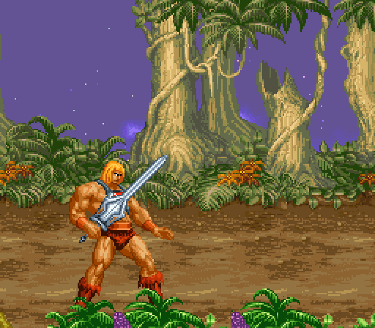

# SNES-BOR

A Super Nintendo and SA-1 research project for building a source-informed
Beats of Rage runtime. The repository contains a legacy converted-content demo
and **BYOR (Bring Your Own Rage)**, a capability-driven source inspection and
compiler toolchain for a bounded subset of Beats of Rage/OpenBOR data.

## Current status

The repository contains two distinct kinds of work:

- **Legacy BOR demo:** the accepted G13/G14 feature scope documents a playable
  converted-content slice with independent P1/P2 input and score/lives/continue
  ownership, shared camera/tether, either-controller pause, 1P/2P stage handoff,
  source-normal player selection, and separate player HP/lives/score HUD. These
  claims apply to the legacy BOR demo, not BYOR or the MOTU work. See the
  [accepted feature record](plan_game.md), [G13 implementation/evidence
  checkpoint](docs/g13_two_player_checkpoint.md), and [G14 player-facing
  verifier](tools/verify/game_g14_player_facing.py).
- **BYOR source tooling:** source inspection and compilation are capability
  bounded. Foreign archives can be surveyed, but unsupported requirements stop
  ROM generation. See [BYOR commands and current limits](docs/BYOR.md).

The screenshot below shows He-Man's authored SELECT animation frame 130 in a
native Mesen diagnostic render. It is a rendered pose, not a menu or gameplay
scene; a complete gameplay handoff has not been demonstrated. See the
[image provenance and capture qualification](docs/screenshots/motu-select-pose130-provenance.json).



## Build and run

To rebuild, install the prerequisites in the [build guide](build.md), then run
from the repository root:

```powershell
python build_rom.py
```

This assembles the source and produces the ROM/MSU outputs described in the
build guide. After building, open the generated `distribution/bor.sfc` in Mesen2 with SA-1
and MSU-1 support. `build_rom.py` also writes `distribution/bor.msu`, but it
does not generate PCM audio tracks; supply matching `bor-*.pcm` sidecars beside
the ROM for MSU-1 audio playback.

To inspect a local source archive, substitute its path:

```powershell
py -3.10 byor.py inspect --source "path\to\source.pak" --output out\source-survey.json
```

A successful inspection means the survey completed; it does not mean the source
is buildable. See [BYOR commands and limitations](docs/BYOR.md).

## Project records

- [Game plan and feature scope](plan_game.md)
- [Runtime plan](plan.md)
- [BOR source-fidelity audit](docs/bor_source_fidelity_audit.md)
- [Audio inventory](docs/audio_inventory.md)
- [Archived former README and milestone notes](docs/development-history.md)

These records were written at different checkpoints and may disagree. Use the
source-specific audit and its evidence for the scope it covers; do not infer a
complete campaign, general OpenBOR compatibility, or a finished MOTU port from
a diagnostic screenshot or isolated native test.

## Source assets and licensing

Large third-party PAK archives are local inputs ignored by Git; they are not
included in this repository. This checkout has no top-level `LICENSE`,
`COPYING`, or `NOTICE` file. Review the applicable source-asset terms before
using or redistributing any source archive or derived material.
