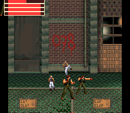
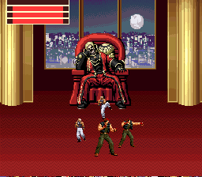
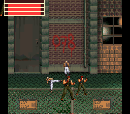
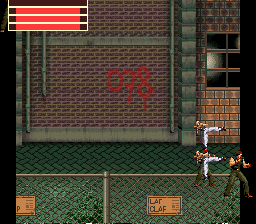
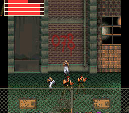
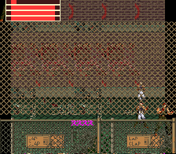

# snes-bor — Beats of Rage SNES Engine Proof-of-Concept

A Super Nintendo Entertainment System (SNES) proof-of-concept targeting real SA-1 coprocessor hardware, with MSU-1 asset streaming and a ported Terrific Audio Driver (TAD).

**This is a hardware-pipeline proof-of-concept, not a playable game.** Four independently-animated characters now render simultaneously — one dpad-controlled, three AI-controlled that walk toward the player and attack in range, with AABB collision producing a real hit reaction — over a converted, camera-scrolled Beats of Rage level backdrop, with a BG3 health-bar HUD and TAD music playing on the S-DSP. AI entities now react at 0 HP (stop acting, stop taking/dealing hits, sprite hides); the player is deliberately exempt (no game-over) and there is still no game loop — see [Current Status](#current-status) below for exactly what does and doesn't work today. `SNES-BOR-Engine-Prompt.md` is the original design spec for the full engine; much of it is still unbuilt, and [plan.md](plan.md) is the live roadmap for the rest.

---

## Screenshots

Captured from a build in Mesen2 on BOR's stage 1A (`DATA\EASY\1AEASY.TXT`), streamed through the Phase 9 tile cache. **Not current**: as of Phase 14 (2026-08-16, see [Current Status](#current-status)) the shipped ROM boots stage 1B instead — these screenshots predate that swap and haven't been recaptured yet. Everything on screen is streamed from `bor.msu` at runtime — nothing here is baked into the ROM.

| Player HP 36/64 | Player HP 0/64 | Player HP still 0, later |
|---|---|---|
|  |  |  |

Four characters (2 Ralfs + 2 JHUNs — the roster holds two, so each appears twice) render as large 32×64 hardware OAM sprites against a real converted Beats of Rage level.

The stacked red bars at the top left are the BG3 HUD, one bar per entity, driven by that character's own `CHAR_HP` byte and redrawn only when it changes. **The topmost bar is the player** (entity 0 — "the player is always slot 0"). Measured off the three shots above, it is 36 px of 64 in the first and empty in the other two. An empty bar draws no red at all, so the right-hand two shots show three bars, not four.

The three AI bars stay full because damage is *not* one-directional but the AI hasn't landed a hit on itself in these particular captures — `Character_HitApply_VsPlayer` costs the player HP and `Character_HitApply_VsEntity1/2/3` cost the AI entities theirs, all four at `CHAR_HP_PER_HIT` (4) per landed hit, clamped at 0, out of `CHAR_HP_MAX` (64).

These particular shots predate the damage system below — none of the three AI has reached 0 HP in them. As of Phase 11, an AI entity reaching 0 HP does react: it stops moving/attacking and its sprite hides (no death animation — the MSU roster has none). The player is exempt; its own bar going to 0 (shown here) still has no reaction, by design.

### Scrolling

The level extends 1920px past one screen (256px), and the camera follows the player. The shot below is further into the same level, past a full screen of the opening alley — the streaming tile cache has evicted those tiles from VRAM and resolved new ones (fresh graffiti, a different brick pattern) as the camera moved past them, not just panned a single static image. It was captured at the real dpad movement speed (`PLAYER_SPEED`) with the resolver given time to settle, and checked against ground truth (0 stale tiles in the visible viewport) before saving — a first attempt at this shot used an unrealistically fast scripted camera jump and genuinely showed cache-eviction garbage; that was a bug in the capture method, not the engine, but it's worth saying plainly rather than quietly swapping the image.



The scroll is real hardware state, not a screen-space camera trick: `$210D` (BG1HOFS) is written from the same eased `Screen_PosX` every vblank, and the player's/AI's OAM X positions are computed screen-relative (world X minus camera X) every frame, including deriving OAM's X-high bit when that goes negative-of-256. There's still no vertical or diagonal scroll — BOR levels are horizontal-only side-scrollers, so none is planned.

**The fence in `scene_scrolled.png` above predates the Phase 10 fix below** and still shows the old behavior (rendering behind the characters) — it's kept as-is rather than recaptured, since it's a useful before/after alongside the shot below.

### Frontpanel foreground layer

| At boot | Scrolled ~125 columns in |
|---|---|
|  |  |

The chain-link fence renders **in front of** the characters (compare against `scene_scrolled.png` above, captured before this fix) — Phase 10, `plan.md` §2.10. This is a second, independent streaming tile cache on BG3 (2bpp, using the same per-tile priority bit the HUD already proves works), loaded at boot the same way the BG1 backdrop is, and kept correct as the camera scrolls by its own per-frame resolver (`Core_StreamScrollFp_*`, mirroring BG1's own `Core_StreamScroll_*`) — verified in both scroll directions, not just the boot-time view.

---

## Current Status (2026-08-16)

### Working and verified

**Most recent work — a real 4th distinct character, Yashiro (`plan.md` §2.15, Phase 15).** Entity #3 previously reused roster slot 1 (JHUN) a second time, a Phase 5-era placeholder. Converted Yashiro — picked because it's the most-spawned enemy in the shipped level's (stage 1B) own spawn table — via the existing `tools/bor_converter/convert_character.py` pipeline and added it as roster slot 3; all 4 entities (player + 3 AI) are now visually distinct characters. Two hand-synced changes: `main.pasm`'s Entity #3 init param (`$0301`→`$0303`, roster slot 1→3) and `core/spawn.pasm`'s `SPAWN_MSU_OFFSET` (re-synced for the roster's new size, same `check_spawn_constants` mechanism as every earlier asset-size change). Along the way, `phase11_damage.py` threw a real-looking FAIL — entity 3's `CHAR_FRAME_INDEX` read as frozen across its 6×40-frame sampling loop — that turned out to be a pure test artifact, not an engine bug: Yashiro's own attack-animation cycle period happens to evenly divide the test's 40-frame sampling stride, so every sample landed on the same phase (a strobe/aliasing effect), confirmed by single-frame-stepping and by re-sampling at a 37-frame (prime) stride, both of which showed normal animation. Fixed by switching the test's stride to 37. `phase12_roster.py`, already generalized in Phase 12 to derive its checks from `roster_count` dynamically, needed zero further changes and passed immediately against the 4-character roster. Full regression suite (`audit_all.py`, `check_label_drift.py`, `phase5.py`, `phase6.py`, `phase7.py`, `phase9.py`, `phase11_damage.py`, `phase12_roster.py`) passes; `phase8.py` fails, but that predates this phase — it gates the pre-Phase-9 whole-level-static-BG scrolling shape, which stage 1B (shipped since Phase 14) isn't, a known-stale gate rather than a regression.

**Earlier work — a second real level, now the shipped default (`plan.md` §2.14, Phase 14).** Stage 1B ("The bar", `DATA\EASY\1BEASY.TXT`) replaces stage 1A as what `distribution/bor.sfc` boots — 1A's converted assets (`out/bg_stage1a`, `out/fp_stage1a`, `out/spawn_stage1a`) stay committed and buildable, same "old level stays available, just not shipped" pattern already established when 1A itself replaced the old synthetic `out/bg_boss_level`. 1B was picked specifically to be a different shape than 1A, to prove the Phase 9/10/13 pipeline generalizes rather than being tuned to one level: only 2 distinct panel images (140 tiles wide vs. 1A's 408, still needs streaming — 2347 unique tiles), and **no frontpanel layer at all** (`level.frontpanel is None`, not just unconverted — `FP_SCREENS = [None]` in `build_rom.py`, the first real exercise of `pack_msu_roster.py`'s "no frontpanel for this BG" path). A real, different spawn table (28 records vs. 33, same `build_spawn_table.py`/`spawn_parse.py` from Phase 13, no code changes needed) includes non-enemy prop spawns (`Table`, `Chair`) and a `2pitem` keyword the parser doesn't recognize — silently ignored by design, same as any other unmodeled field. Running the full regression suite against the new level surfaced one real, level-specific test bug (not an engine regression): `phase5.py` assumed exactly one spawn record fires at boot with no camera movement, true for stage 1A but not 1B, which has two (`Table`/`Chair`, both `at 0`) — so entities 1 *and* 2 spawn immediately at boot, and the old "entities 2/3 stay unspawned" assertion correctly failed against real, working Mesen2 data. Fixed by generalizing the check (either unspawned or fully spawned, matching `phase6.py`'s already-permissive pattern) instead of hardcoding a specific level's trigger layout — now robust to whatever the next shipped level looks like. Full regression suite (`audit_all.py`, `check_label_drift.py`, `phase5.py`, `phase6.py`, `phase7.py`, `phase9.py`, `phase11_damage.py`, `phase12_roster.py`) passes against the new level, including `phase6.py`/`phase9.py` confirming they really do read the level's own manifest data (`width_tiles=140`, 2347 tiles) rather than hardcoding stage 1A's numbers.

**Earlier work — real enemy spawn waves, driven by stage 1A's own level script (`plan.md` §2.13, Phase 13).** Through Phase 12 the 3 AI entities stood fully alive from frame 1 with nothing to fight and no relationship to the source level's actual content. `tools/bg_converter/spawn_parse.py` + `build_spawn_table.py` (new) parse stage 1A's real `spawn`/`at` script blocks (33 spawn events) and bake them into a flat 7-byte-record table (trigger world-X, spawn position, facing), applying the same 0.8x scale the backdrop converter uses so positions land in the same world-pixel space. `core/spawn.pasm` (new) walks this table at runtime as a single global queue: each frame, if the camera has reached the next pending record's trigger and an AI slot is free, that slot gets (re)spawned; AI entities now boot at `CHAR_HP=0` (reusing Phase 11's soft-kill sentinel as "unspawned") instead of full HP, so they stay hidden until the level's own script places them. The table ships via `bor.msu` (a new spawn section in `pack_msu_roster.py`), not a ROM `.incbin` — this codebase has no proven pattern for indexed ROM reads, and CLAUDE.md documents a confirmed Poppy bug in exactly that addressing mode, so the table is read sequentially into WRAM at boot instead, then indexed there using the same `.l Label,x` pattern already proven throughout the engine. A genuine Poppy bug surfaced along the way: a real "Branch target out of range" build error was reported as `src/main.pasm:167`, which turned out to be `core/spawn.pasm`'s *own* line 167 — Poppy's `.include` error reporting apparently reuses the included file's line number under the main file's name. Fixed with this project's standard long-branch workaround (`brl` instead of a `bcc` whose target sat past the whole rest of the routine). Verified in Mesen2: a passive no-input boot spawns exactly the one `trigger_x==0` entity, which then walks toward and visibly damages the player over ~900 frames, confirming the full pipeline end to end; `phase5.py`/`phase6.py`/`phase11_damage.py` were updated (not loosened) to reflect that AI entities now read `CHAR_HP==0` until spawned. Full regression suite (`audit_all.py`, `check_label_drift.py`, `phase5.py`, `phase6.py`, `phase7.py`, `phase9.py`, `phase11_damage.py`, `phase12_roster.py`) passes, including `phase9.py`'s sustained-held-input run (confirms no stall/vblank-overrun regression from the new per-frame check). Scope: no `wait`/`group` (respawn-pool/scroll-block) semantics, no per-spawn HP override, and every record spawns a generic AI-seeking enemy using whichever roster character (Ralf/JHUN/JOE) is already wired to the slot it lands in — the source level's specific character identity and non-enemy spawns (the `1up` pickup, the `trash` prop) are not modeled. Still no level-transition or win-condition logic.

**Earlier work — closed the Phase 9 gate's two open follow-ups (`plan.md` §2.9's "Phase 9 gate" section).** Real-play scroll-lag magnitude had never been measured against sustained realistic held-dpad input, only a scripted WRAM position sweep, and there was no self-contained `phase9.py` gate — both flagged as open in `plan.md`. Driving the camera with `m.set_input(BTN_RIGHT, ...)` against the live shipped ROM resolved the first: `set_input` does move the camera correctly — a prior session's "camera never advanced" observation was a short-hold-window race against `run_frames`, not a broken tool or a real gap (a 10-frame hold paired with a 10-frame run produced unreliable partial presses; a 30-frame hold with a 35-frame run gave clean, consistent movement). With reliable input, a real finding emerged: the camera itself never lags behind the player (`Screen_PosX` tracks a constant ~144px follow offset that doesn't grow), but the player's own movement throughput periodically dips under sustained rightward travel — down from nominal `PLAYER_SPEED` to brief near-zero windows — correlated with the streaming tile cache's desired window catching up to its resident window, i.e. the shared per-frame DMA-queue budget under load. Not a bug fix — this is the same actively-tuned budget tradeoff already documented for the streaming cache — but now bounded and gated: `tools/verify/phase9.py` (new, added to the routine suite) asserts no stall run longer than 2 sample windows and camera lag behind the cache's own high-water mark stays under one screen-width. It needs no `BG_SCREENS` swap, unlike the older `phase9_stagecolumn_spotcheck.py`/`phase9_syncscroll_test2.py` pair — the shipped level (`out/bg_stage1a`) is itself a streaming level now, so this is the first time the streaming engine has been exercised against `distribution/bor.sfc` as actually built, not a temporary synthetic-asset config swap.

**Earlier work — expanded the roster past 2 characters (`plan.md` §2.12, Phase 12).** A real third character, JOE, was converted from `Beats of Rage Original [v.3.0 Build 4086].pak` via the existing `tools/bor_converter/convert_character.py` pipeline (idle/walk/attack1, same shared-palette quantization already used for JHUN) and added as roster slot 2 in `build_rom.py`'s `ROSTER_PREFIXES`. No engine-side roster-count logic needed to change — `CharSelect_RosterCount` is read from the packed `.msu` file's own header byte at runtime, and the file format already supported up to 8 characters. `CharacterEntity_Init`'s Entity #2 now loads roster slot 2 (JOE) instead of duplicating Ralf a second time, so the default composition is now Ralf (player)/JHUN/JOE/JHUN instead of 2 Ralfs + 2 JHUNs. Writing this phase's own verify gate found and fixed a real pre-existing bug the expansion exposed: `CharSelect_Index` is shared scratch that every entity's own boot-time init reuses, left holding whatever roster slot was created LAST (not the player's own); the player's first Select press after boot read that stale value and skipped a roster slot entirely (confirmed: jumped straight from Ralf to JOE, silently skipping JHUN) — invisible with only 2 roster slots, a real bug with 3. Fixed with a one-instruction reset after all four entities finish their own boot-time loads. Verified in Mesen2 with a new `tools/verify/phase12_roster.py` gate: three Select presses from boot produce the palette sequence Ralf→JHUN→JOE→Ralf exactly (`CharSelect_Index` reads `[0,1,2,0]`), all three characters are pairwise distinct, the wrap matches the original, and Entity #2's own palette independently confirms it loaded JOE at boot. Passed deterministically across 2 runs. Full regression suite (`audit_all.py`, `check_label_drift.py`, `phase5.py`, `phase6.py`, `phase7.py`, `phase11_damage.py`) still passes.

**Earlier work — a damage system: AI entities react at 0 HP (`plan.md` §2.11, Phase 11).** `CHAR_HP`/the HUD already worked (Phase 6); the only gap was "nothing reacts at 0." The obvious fix — killing the entity via `core/oop.pasm`'s generic garbage-collect path — is a trap specific to this codebase: `Entity1_Base`/`Entity2_Base`/`Entity3_Base` are compile-time-fixed WRAM literals, not derived from each entity's `OopDp` at runtime, and GC-reclaiming an earlier slot compacts `OopObjRam` and rewrites *surviving* entities' `OopDp` — silently breaking every hardcoded `EntityN_Base` reference elsewhere in the codebase (`Character_HitApply_VsEntity2/3`, etc.), the same class of hazard CLAUDE.md's "player is always slot 0" note warns about. The fix instead is a soft-kill using `CHAR_HP==0` itself as the sticky dead flag — no new struct field, `OopObjRam` never touched: a dead AI entity (`CHAR_INPUT_DRIVEN==2` only — the player is exempt, no game-over) stops acting (`Anim_Play` returns immediately, so it never streams another MSU-1 frame and never spends the shared one-entity-per-frame streaming budget on an invisible corpse), stops moving (`Character_PlayFrame` freezes its position via the same hold-path hit-stun already uses), stops taking or dealing further hits (`Character_HitApply_VsEntityN` refuses to re-stamp a target already at 0 HP), and its hardware OAM sprite hides (`Y=$F0`, the established "clean OAM" idiom — not a sentinel X, which Phase 8's 16-bit world-coordinate AI-seek math would misread). Verified in Mesen2 with a new `tools/verify/phase11_damage.py` gate: forcing one AI entity's HP to 0 and running 600 real frames confirms its position freezes, its hardware OAM Y reads `$F0`, it takes no further hit stun, `Nmi_FrameCounter` keeps advancing (no vblank overrun from the new branches), and the other three entities are unaffected (not hidden, HP untouched, still animating) — passed deterministically across 2 runs. Full regression suite (`audit_all.py`, `check_label_drift.py`, `phase5.py`, `phase6.py`, `phase7.py`) still passes.

**Earlier work — the frontpanel foreground layer renders correctly in front of characters AND tracks the camera as it scrolls (`plan.md` §2.10, Phase 10, fully done — Steps 1/2a/2b/2c/3/4).** BOR's `frontpanel` art (e.g. stage 1A's chain-link fence) is meant to occlude characters, but this engine previously baked it into the same flat static BG1 image as the backdrop, where hardware OBJ sprites always render above it — the opposite of real BOR's depth ordering (see `scene_scrolled.png` above for what that looked like). The fix generalizes Phase 9's own streaming tile-cache mechanism to a second, independent cache on BG3 (2bpp, using the same per-tile priority bit the HUD already proves works above OBJ): `tools/bg_converter/convert_frontpanel.py` (535 unique tiles / 143 worst-case per 40-column window, 9-color CGRAM budget), `src/core/stream_cache_fp.pasm` (the allocator), `Bg_LoadSceneFp_Streaming`/`StageColumnFp_FetchTilePixels` (the boot-time initial-viewport loader), and `Core_StreamScrollFp_*` (`src/main.pasm`, a per-frame resolver mirroring BG1's own `Core_StreamScroll_*` — one real simplification, not just a smaller copy: BG3's tilemap is a single 32×32 map exactly the size of one viewport, so unlike BG1 there's no prefetch margin, and only the 7 real-content rows are ever resolved, confirmed blank everywhere else across the full 192-column level). Getting this working end-to-end surfaced and fixed seven real bugs across the two steps (row-offset double-count, scratch-cell aliasing with live BG1 state, a boot-ordering clobber, an off-by-32-tiles BG3 CHR-base addressing bug, a window-width-tracking bug that let the resolved window grow past its 32-column physical ring, a chained-ADC carry-propagation bug that silently corrupted a computed seek address, and a DMA-queue-contention cache-corruption bug — shared by BG1's own resolver too, not FP-only — where the streaming cache's slot-allocation tables were committed before confirming the DMA that would actually write the tile's pixel data was guaranteed to fire, fixed with a new `Core_Dma_HasFreeSlot` guard in `src/core/dma.pasm`) plus one in the converter (`tiledpalettequant.build_palettes_tileaware` never actually indexed transparent source pixels to palette slot 0 despite accepting a `trans_color` parameter). See `plan.md` §2.10 Steps 2b/2c and `handoff.md`'s Phase 10 section for the full bug-by-bug writeup. Verified in Mesen2 (see screenshot below, and a scripted 900-column-right-then-900-column-left scroll test rendering cleanly in both directions, plus a targeted pixel-level VRAM check comparing every non-blank tile across the resolved window's 7 content rows against the converter's own ground truth byte-for-byte — 224/224 match on the fixed build) and against the full regression suite (`check_label_drift.py`, `audit_all.py`, phase5/6/7 — phase5's settle-time window and phase6's CGRAM ground truth were both updated to reflect legitimate behavior changes, not loosened to pass). **Step 4, a committed `tools/verify/phase10_frontpanel.py` regression gate (same ground-truth/Tile2Slot-consistency approach as `phase9_syncscroll_test2.py`), is also done and passes deterministically** — Phase 10 is now fully closed.

**The shipped ROM also streams a real, full-size Beats of Rage level (`plan.md` §2.8, Phase 9).** `build_rom.py`'s `BG_SCREENS` ships `out/bg_stage1a` — BOR's actual stage 1A (`DATA\EASY\1AEASY.TXT`), 6 screens/1920px wide, 2,458 unique tiles level-wide, far past the ~1,000-tile ceiling a static whole-level load can hold in VRAM at once. A ring-buffer VRAM tile-slot cache (`src/core/stream_cache.pasm`, 1,022 usable slots) plus a runtime engine (`Core_StreamScroll_*` in `src/main.pasm`) extends/repairs a camera-relevant resident window on the fly, streaming individual tiles from `bor.msu` on cache miss. Verified end-to-end in Mesen2: a full scripted traversal from world X=0 to 1880 renders cleanly with no corruption (screenshots show real graffiti/brick/window art, not placeholder blocks), and both ground-truth scripts pass against this real level — `tools/verify/phase9_stagecolumn_spotcheck.py` (896/896 boot-time viewport tiles byte-exact) and `phase9_syncscroll_test2.py` (0 hard mismatches after a full-level camera sweep). This is a real product change, not just an engine proof: the previous shipped level (`out/bg_boss_level`, still fully intact and buildable) is no longer what boots by default. See `plan.md` §2.8 for the full mechanism, the bugs found building the engine itself (a Poppy-fork silent-miscompile on a two-term `adc` immediate, a `TileBuf` double-fetch, a `CommitColumn` hang, and a repair-sweep-scope bug that caused a stale-tile metric to never converge), and the "UPDATE" note there for what wiring in a real level required (three test-script fixes, zero engine-code changes) and what's still open (real-play scroll-lag under sustained held-dpad input is still only tested via a scripted position sweep; there's still no self-contained `phase9.py` gate). §2.9 lists other candidate next steps.

**Before that — real horizontal scrolling with a live camera (`plan.md` Phase 8).** `tools/verify/phase8.py` reports `PHASE 8: PASS` (12/12 checks). See the Scrolling screenshot section above for what it looks like; the mechanism: `CHAR_POS_X`/`CHAR_POS_Y` are now 16-bit world coordinates everywhere they're read, `core/screen.pasm`'s camera engine (576 lines, previously wired in but with zero consumers) now has a real one via a new `CharacterEntity_OnCommand` handler answering its `SCREEN_CMD_GET_CAMERA_DATA` query, and the eased camera position is committed to the real `$210D` (BG1HOFS) register every vblank. This ships the "cheap version": the boss level's real content is 588 unique tiles, so it loads as one static whole-level 64-wide BG1 map at boot rather than needing a streaming tile cache (built later, see plan.md §2.8/Phase 9 above). Along the way, found and fixed a genuine, previously-latent WRAM collision in `core/oop.pasm` — `OopCall_ResultX`/`OopCall_ResultY` had resolved to the same addresses as `OopFlags[0]`/`[1]`, inert until this phase's camera query became the first real writer through them.

**Before that — TAD audio actually plays (`plan.md` Phase 7, previously ⛔ blocked at its own gate).** `tools/verify/phase7.py` now reports `PHASE 7: PASS`. Getting there meant fixing four silent assembler miscompiles and one real porting bug; none of it was the TAD driver's own logic.

- **The failure mode worth knowing about: every status byte read perfect while the driver played nothing.** TAD sat at `TadState::PLAYING` (`$82`) with the S-DSP out of reset (`FLG=$00`) and main volume at 127/127 — and emitted pure silence, because it had faithfully loaded a song consisting entirely of zeros. `Tad_DataTable`'s entries are offsets from the start of the ca65 *audio data segment*, and upstream `LoadAudioData` converts them with the standard LoROM dance (`ora #$8000`), which is only correct when that segment is linked to start at LoROM `$8000` of its own bank. This project is confined to bank 0 (Poppy's `.bank N` handling is broken), so the blob is `.incbin`'d mid-bank at `$B02B` and every computed address came out `$302B` too low, landing in the zero padding ahead of `.org $8C00`. Fixed by rebasing onto the real segment base — which is `__Tad_AudioData_0 - 51`, since that segment opens with the 51-byte `LoadAudioData` callback before the blob (`main.pasm`'s comment claiming a "43-byte callback" was wrong; `audio-data.s:117` asserts 51). The arithmetic pins it exactly: the data table sits at blob offset 3337 and is 8 bytes, so data starts at 3345, and entry0 `$0D44` = 3396 − 51 = 3345, while the end entry `$108A` = 4234 − 51 = 4183 = the exact size of `audio-data.bin`.
- **Root cause found for this project's long-running "label drift" assembler bug.** Poppy sizes `jsl <label>` as 3 bytes during its address-estimation pass and emits the correct 4, so every label after a `jsl` resolves one byte early — and the error *accumulates*, one byte per `jsl`. The TAD region contains exactly three `jsl`s and the measured drift across its 27 broken labels stepped 1 → 2 → 3 immediately after each one. Four of those broken labels were individually fatal: one made the `LoadAudioData` success path fall through a stray `TXA` (storing the data address's low byte as its *bank*), one turned `Tad_LoadSong`'s state guard into dead code that never executed (so the common audio data was never transferred at all), and one put `TadPrivate_Process_Loading` on the previous routine's `rtl`, making `Tad_FinishLoadingData` spin forever without ever calling `TransferData`. A fifth bug was separate: Poppy **silently deletes** a branch whose target is a dot-prefixed local label (`bcc .valid`), emitting neither the branch nor the label.
- **New tool: `tools/rom_audit/check_label_drift.py`.** It asserts that the byte at each label's address is an opcode for the mnemonic the *source* puts on the next line — or, where a guard `nop` is present, that the expected instruction really does follow the whole nop run. (Accepting a bare `$EA` on sight was the tool's own first version, and since ~40% of labels take that path it hid a live case: `Tad_LoadSongIfChanged` sat on the tail of the previous routine's guard and resolved onto that routine's `rtl`.) It reports the exact padding needed per label and exits nonzero so it can gate a build. It sweeps the whole ROM and follows `.include`s — drift accumulates within an `.org` region and resets at the next one, so checking only the region you edited proves nothing about the rest, and two thirds of the 497 labels it checks are defined in `src/core/*.pasm`. This matters because the existing `rom_audit` checks are structurally blind to this bug class — they verify a branch target lands on a valid instruction boundary, and a drifted label usually does, just the wrong instruction. `audit_all.py` returned `ALL CHECKS PASS` the entire time the audio driver couldn't load a single byte.
- **Verification.** Recorded S-DSP output peaks at 23082 on all three runs (it was 0 / 13 / 2917 while the base was still wrong). The gate deliberately does not trust the engine's own status bytes: it byte-compares ROM against `soundwork/tad/build/audio-data.bin` and pins the drained transfer pointer to the exact end of the blob. The waveform assertion is majority-of-3 per `plan.md` §2.5's warning about this harness's ~40% false-silent rate, plus a distinct-`sha256`-across-runs check — real playback differs every run, whereas the pre-fix silence was byte-identical every time.

**The entity system (`plan.md` Phases 0–5, all committed and verified).** This is what took the project from "one sprite on screen" to "four characters interacting simultaneously," and it is the part most likely to be relevant if you're picking this up:

- **MSU-streaming serialization (Phase 0, `fd9bcdc`).** A real, deterministic data-corruption bug that could only manifest once a *second* entity started animating, so it had never been hit. `Msu1_LoadFrame` streams a frame through a single shared staging buffer and enqueues 6 row-DMAs; two entities advancing on the same frame would interleave into that one buffer and blow the 8-slot DMA queue. Fixed with an `Msu1_StreamBusy` flag that serializes streaming to at most one entity per frame; entities that don't get a turn simply retry next frame. **Consequence, by design:** with N entities on screen each character's animation advances at most every N frames. At N=4 that's ~15fps of animation against a 60fps game loop. This is correct behavior, not a performance bug.
- **The character became a real object class (Phase 1, `fd9bcdc`).** `CharacterEntity` is now registered with `core/oop.pasm` and dispatched through it, with all per-character state (position, facing, frame index, animation selection, roster index, palette slot, tile column) living in that instance's own Direct Page window inside `OopObjRam` rather than in file-scope globals. `core/oop.pasm` switches the DP register per instance before calling `Init`/`Play`, so the same code drives every character.
- **Two simultaneous entities (Phase 2, `e7d18eb`, `f2f52e0`).** Each gets its own OBJ palette slot (CGRAM `$100 + slot*32`, written by its own `Anim_LoadCharacter`) and its own 4-tile-wide column slice of the OBJ tile sheet. Verified against *hardware* OAM (`snesSpriteRam`), not just the WRAM shadow, and checked for DMA starvation.
- **Minimal enemy AI (Phase 3, `78f2acb`).** Each AI entity computes Chebyshev distance to the player every frame, walks toward them on both axes, and triggers its attack animation within ~30 pixels.
- **AABB collision and hit reaction (Phase 4, `a32d88f`).** On overlap during an attack, the target gets `CHAR_HIT_STUN` frames during which its animation is forced to idle and its movement is held. No HP/damage tracking at this point in the project's history yet — that came in Phase 6, and a real reaction to reaching 0 HP came later still, in Phase 11 (see "Most recent work" above).
- **Scaled from 2 to 4 entities — 1 player + 3 AI (Phase 5).** No VRAM layout change needed: the OBJ tile sheet holds 8 of these 32×64 sprites (256 tiles ÷ 32 tiles/sprite), so 4 was always free. `Character_HitApply`'s player-attack path now checks all 3 AI slots in sequence via 3 separate `jsr`'d leaf routines (kept separate rather than inlined or parameterized-by-register — see the toolchain traps below). At this point in the project's history only two characters existed in the roster (Ralf, JHUN), so 4 entities meant 2 Ralfs + 2 JHUNs — the two of each rendered identically (same source palette, not a bug). Phase 12, later, added a real third roster character (JOE) and gave Entity #2 its own distinct slot instead of duplicating Ralf — see "Most recent work" above.
  - **Fixed a live, pre-existing bug this scale-up exposed**: `Character_BlankPadding` (blanks each sprite's unused bottom rows) only ever handled tile-column-slice 0 — every other entity displayed uninitialized VRAM in the bottom 16 pixels of its sprite. Confirmed via direct VRAM reads before the fix (garbage, different bytes every run) and after (all zero, every slice).
  - **Found and fixed a second bug the 4-entity case exposed**: all 4 entities' palette-load DMAs shared one WRAM staging buffer and were flushed in a single batch at the end of entity creation. With only 2 entities this coincidentally always looked correct; at 3+, the earlier entities' palettes got silently overwritten by later loads before the batch flush ran. Fixed by flushing each entity's palette DMA immediately after its own load.
  - **A third bug, found and fixed**: entity 0 (the player)'s own palette read back one wrong color (color 1), 100% reproducibly, confirmed against `bor.msu`'s raw bytes as ground truth. Not an MSU-1/track-select timing hazard as first suspected — the real cause was `TestSprite_Init`, a leftover one-time OAM bring-up routine that runs later in `scpu_boot` and unconditionally overwrites CGRAM colors 128/129 (OBJ palette 0, i.e. `CHAR_PALETTE_SLOT=0`, the player's real palette) with hardcoded test values. Fixed by moving that routine's writes to an unused palette (4). See `handoff.md`'s Phase 5 section.
- **BG1 static backdrop + BG3 health-bar HUD (Phase 6).** A real converted Beats of Rage level renders behind the characters, with four health bars over it. Three new pieces:
  - **`tools/bg_converter/` — the level-tileset converter that gated this phase.** Parses a BOR level `.txt` (`background` / `panel` ×N / `frontpanel` / `order`), composites one static 320×240 screen at scroll position 0, resamples to 256×224, then does flip-aware tile dedup, k-means tile-aware sub-palette assignment (via `tiledpalettequant.py`, adapted from the sibling SNES-SuperMonkeyIsland project), 4bpp planar packing, and real-SNES tilemap words. Its `preview.png` is decoded back *out of* the emitted binaries, so an encode bug shows up as a visibly wrong image rather than a silent one.
  - **`bor.msu` format v2.** A BG section (CGRAM image + BG1 tilemap + BG1 tiles + BG3 HUD tiles) is appended after the character blobs, so no character `data_offset` moves. `Bg_LoadScene` streams it MSU-1 → PPU directly with no WRAM staging — the blob is ~16KB and there is no free 16KB WRAM region — as a one-shot at boot under forced blank, which is also why it adds no per-frame DMA consumer.
  - **`CHAR_HP` and a dirty-gated HUD.** HP is decremented where `CHAR_HIT_STUN` is already stamped and clamped at 0; at this point in the project's history it just gave the HUD something real to draw (Phase 11, later, is what made 0 HP actually mean something for AI entities — see "Most recent work" above). `Hud_Play` enqueues nothing on a frame where no HP changed, and sends all four bars as one 256-byte DMA rather than four — the queue has 8 slots and one entity's frame load already takes 6.
  - **Two more silent-toolchain/hardware traps, both caught only by byte-comparing against the converter's own output.** (1) `cpx.l` — CPX has **no** long addressing mode on the 65816, but Poppy assembled it anyway and emitted an encoding that desynced the instruction stream and scribbled over CGRAM. (2) `$2115` (VMAIN) was still 0 when `Bg_LoadScene` ran, because it executes earlier in boot than the `$2115` write everything else relies on — VRAM addresses advanced on the wrong write and sheared every upload by one byte.
- **Five toolchain traps were found across Phases 4–6, all worth knowing before writing any 65816 here.** (1) A conditional branch (`bcs`) whose target exceeded the ±127-byte range **assembled with no error at all** and hung the CPU at runtime — symptom was `Nmi_FrameCounter` freezing and every WRAM read returning a fixed value. (2) Poppy's accumulator-width tracking is linear and not control-flow-aware, so a label reached by a branch that jumps *over* a `rep`/`sep` gets its following immediate operands mis-sized; the ROM then contains a phantom `BRK` mid-routine. Both were found only by live Mesen2 testing plus direct disassembly. **`tools/rom_audit/*` returned byte-identical clean results before and after the first of these** — the audit checks that decoded bytes land on real instruction boundaries, never that the logic is correct. (3) The DMA-queue palette hazard above is a third, distinct class: a correctness bug that hid behind a 2-instance coincidence and needed byte-exact ground-truth comparison (against the source `.msu` file, not just cross-entity equality) to actually catch.

**Earlier verified work**, roughly oldest to newest:
- **SA-1 boot + BW-RAM canvas draw.** SA-1 draws a static 4-color test pattern (four colored blocks, not real sprite art) into its BW-RAM canvas at `$60:6000`. Confirmed directly in this session by reading SA-1's own memory view after boot.
- **TAD (Terrific Audio Driver) SPC700 boot handshake.** The ported driver previously hung forever inside the SPC700's IPL boot ROM and never started — a stray `| $80` in the "new data" command byte (`main.pasm`, `Tad_Init`) broke the IPL's exact-match check. Fixed. Verified in a hand-patched binary that reached the driver's `PLAYING` state; the fix is now also in source and reassembles to the same bytes.
- **MSU-1 real audio track playback.** Previously the MSU-1 code only checked for hardware presence and read back a hardcoded test string from `bor.msu` — it never actually played a track. This session added a real track-select + play/repeat trigger and proved it produces actual audible output: captured the emulator's real mixed audio stream, confirmed a non-silent waveform with the expected repeating pattern. (Test uses a voice clip borrowed from another project purely as a proof-of-concept audio source — not a Beats of Rage asset.)
- **Poppy assembler now builds and runs on this machine.** Poppy targets `net10.0`; the system-wide `dotnet` here is 8.0. Use the user-local .NET 10 preview SDK instead: `C:\Users\chad\.dotnet\dotnet.exe`. See [build.md](build.md).
- **`src/core/` utility modules.** Ported from [SNES-SuperBossGaiden](https://github.com/snesdev0815/SNES-SuperBossGaiden) (WLA-DX → Poppy syntax, used with the original author's permission — see module headers for exactly what changed). Wired into the real boot path and confirmed assembling to the correct bytes and (for `random.pasm`) the correct seeded runtime values:
  - `core/random.pasm` — 8-bit PRNG. `Core_Random_Init` called at boot; nothing currently calls `Core_Random_Get`.
  - `core/input.pasm` — single-controller press/trigger/old edge detection via hardware auto-joypad-read. `Core_Input_Init` called at boot, `Core_Input_Poll` called every `scpu_main_loop` iteration; `Input_press`/`Input_trigger` drive the player character's movement, attack trigger, and facing via `CharacterEntity`'s `CHAR_INPUT_DRIVEN=1` path.
  - `core/math.pasm` — 8×8/16×16 multiply, 16-bit divide, min/max/abs. Not yet called from anywhere; available for when entity/collision code needs it.
  - `core/error.pasm` — crash-screen handler (`Core_Error_Handler`): halts, sets forced blank, and hangs so an emulator debugger can catch the resulting error code left on the stack. The `@Core_Error_Trigger` macro it defines is not invoked directly anywhere in this codebase — see the assembler-bug note below for why every call site inlines the same two instructions by hand instead.
  - `core/dma_channel.pasm` — allocator for the 8 hardware DMA channels (`Core_DmaChannel_Init`/`Allocate`/`Deallocate`), tracking which channels are in use so `core/dma.pasm` and future code don't collide.
  - `core/dma.pasm` — software DMA queue (`Core_Dma_Init`/`Enqueue`/`ProcessQueue`, plus `TransferVram`/`Oam`/`Cgram` helpers) so multiple systems can request transfers without stepping on each other's channel.
  - `core/allocate_wram.pasm` — fixed-size block allocator (`Core_Wram_Init`/`Allocate`/`Deallocate`) handing out 256-byte blocks from a reserved 12KB WRAM buffer. Not yet called by anything other than its own `Init`.
  - `core/allocate_vram.pasm` / `core/allocate_cgram.pasm` — stepsize-aligned region allocators for VRAM (512 blocks of 128 bytes = full 64KB) and CGRAM (64 blocks of 8 bytes = full 512 bytes), same free-list-by-fixed-block design as `allocate_wram.pasm`. Only `Core_Vram_Init`/`Core_Cgram_Init` are called (from `scpu_boot`, clearing their tracking tables); `Allocate`/`Deallocate` on both aren't called by anything yet, so — unlike `Init`, which runs and is boot-verified every build — they're included and byte-verified against their own disassembly, not exercised at runtime.
  - All six `Init` routines are called from `scpu_boot` (`Core_DmaChannel_Init` → `Core_Dma_Init` → `Core_Wram_Init` → `Core_Vram_Init` → `Core_Cgram_Init`, after `Core_Random_Init`/`Core_Input_Init`); `Core_Dma_Enqueue`/`ProcessQueue`, `Core_Wram_Allocate`/`Deallocate`, `Core_Vram_Allocate`/`Deallocate`, `Core_Cgram_Allocate`/`Deallocate` aren't called by anything yet — available for when VRAM/CGRAM/OAM traffic or entity state needs them.
  - Discovered along the way: this Poppy build mis-resolves `@`-local labels once the containing code is reached via `.include` (works fine assembled standalone, fails only when included) — worked around by using fully-qualified global labels throughout `src/core/`, matching `main.pasm`'s existing convention of never using local labels either.
  - **Four more bugs found and fixed while wiring these in** — three in the Poppy assembler itself, one in this port's own design. All four are documented in detail in the affected files' header comments; short version:
    1. **Branch/label address drift via `symbol+N` on long-addressable instructions** (`core/math.pasm`). A bank-`$7E` symbol with a `+N` offset, fed into an instruction that has a long-addressing form (LDA/ADC/STA do; LSR/ROR don't), gets sized 1 byte short during Poppy's forward address-estimation pass versus what it actually emits — and every label after that site in the file inherits the drift. This corrupted a `JSR` target 3 bytes into the wrong function once `math.pasm` was `.include`d ahead of the new modules. Fixed with an explicit `.l` suffix at the two affected sites.
    2. **`.w` on indexed access to a bank-`$7E` symbol silently drops the bank byte.** `sta.w Symbol,x` picks the correct long-addressing opcode but only emits 2 of its 3 operand bytes, so the CPU reads the *next* instruction's opcode as the missing bank byte — corrupting the target address and eating that instruction. Fixed by using `.l` (or bare, unsuffixed) instead of `.w` everywhere across the four new modules. `STZ` has no long-addressing mode on real 65816 at all — `stz.l` doesn't error in this Poppy build, it silently emits a bogus encoding — so those sites use `lda #0` / `sta.l` instead.
    3. **Macro invocations counted as 0 bytes by the forward address-estimation pass.** `@Core_Error_Trigger` (a 2-instruction, 6-byte macro) is sized as 0 bytes during estimation but expands to its full size in the real emit pass, so a branch skipping over one — exactly the shape every validation check here needs — gets a corrupted offset. Fixed by never invoking the macro from a branch-skipped spot; every real call site inlines the same `pea`/`jsr Core_Error_Handler` by hand instead.
    4. **Not an assembler bug — this port's own design error.** `core/allocate_wram.pasm`'s `WramBuffer` was originally placed at `$7E1000`. SNES banks `$00`–`$3F` mirror `$0000`–`$1FFF` onto `$7E0000`–`$7E1FFF`, which is exactly where the hardware stack lives (`scpu_boot` sets `S = $1FFF`) — so `Core_Wram_Init`'s clear loop, walking up from `$7E1000`, was overwriting its own live return address partway through. The loop itself always finished correctly (it's driven by a register, not the stack), which is what made this hard to spot: `Core_Wram_Init` silently returned to garbage right after its last real instruction ran. Fixed by relocating `WramBuffer` to `$7E2000`, outside the mirrored range.
  - `core/allocate_vram.pasm`/`allocate_cgram.pasm` didn't turn up a fifth bug — their `Init` routines disassemble byte-correct and are boot-verified — but *chasing what looked like one* is what surfaced a real problem with the audio check itself: the same unchanged binary alternated between a correct fingerprint and a silent one across repeated runs, at every `boot_wait` tried. **This was later root-caused, not just measurement noise** — see the MSU-1 fix below and build.md's Testing section for the full story.
- **MSU-1 presence detection: root-caused and fixed.** The long-standing "nondeterministic audio" symptom above traced to a real, deterministic bug: `msu1_check_loop`'s `cmp.l msu1_id_str,x` — an indexed reference to a ROM data label — computed the wrong base address for its comparison, so the boot code was checking the hardware MSU-1 ID register against the tail of unrelated preceding instructions instead of `"S-MSU1"`, making the presence check fail almost every time. A sixth Poppy assembler bug, distinct from the branch-target-drift one below: padding inserted before the label did not change the drift (proving the wrong address lives in the referencing instruction, not the label's position). Fixed by replacing the indexed loop with 6 unrolled immediate-byte comparisons. Verified: 5/5 `record_audio` runs now produce a real, non-silent waveform (`peakAmplitude` ~0.928, matching the historically "correct" value), and 7/8 direct reads of the MSU-1 success flag show it set.
- **S-CPU boot crash, root-caused and fixed.** `scpu_boot` never reliably reached `scpu_main_loop` — the CPU could end up executing stray bytes instead of looping. Cause: a fifth Poppy assembler bug, distinct from the four above — a label used as a branch target can resolve 0–2 bytes earlier than where Poppy actually emits the following real instruction, so a branch computed from that (self-consistent, but wrong) address lands mid-instruction in whatever preceded the label. Confirmed after several different preceding-instruction shapes (16-bit immediate loads, `jsl`, `sep #imm8`), so it isn't tied to one local pattern — every backward/forward-branch label in a loop-heavy region needs checking, not just ones matching a suspected trigger. Fixed by inserting `nop` padding immediately before each affected label so the branch's (possibly-early) computed target always lands on real code or a nop that falls through to it. Verified two ways: a purely static check reading the raw byte at every boot-sequence label's exported address (must be the real opcode or `0xEA`), and a behavioral check (fresh emulator sessions reliably reaching `scpu_main_loop`, plus a temporary WRAM iteration counter proving the loop runs continuously rather than hanging).
- **OOP engine (`core/oop.pasm`) and camera/screen engine (`core/screen.pasm`) wired into the real boot path and smoke-tested end-to-end.** `Core_Oop_Init`/`Core_Screen_Init` were previously commented out in `scpu_boot` while `Core_Oop_Play`/`Core_Screen_Play` still ran every frame — a real latent crash risk, since `Core_Oop_Play` does an indirect `jsr` through a class-dispatch table that only `Init` zeroes; without it, that table (and `Core_Screen_Play`'s focus-target lookup) ran against Mesen's WRAM power-on garbage. Both `Init` calls are now enabled. Exercised with a throwaway two-instance test class (registered, played, one instance self-killing after 5 frames, the other running indefinitely) to prove `RegisterClass`/`Create`/`Play` dispatch/`Kill`/`CollectGarbage`-with-slot-reclaim all work — confirmed by reading the engine's own internal state (`OopFlags`, `OopObjSlotPtr`, `OopGarbagePresent`) directly, not just trusting the test's own output. Found and fixed one bug in the (now-removed) test harness itself along the way: its `shouldDie` flag lived at the same byte offset as part of a 16-bit counter store, so the counter write clobbered the flag right after it was set, and the kill path never fired until that was corrected.
- **OAM + NMI shadow-register system (`core/oam.pasm`, `core/nmi.pasm`), ported from SuperBossGaiden and wired into the real boot path.** Every PPU register the game touches (screen brightness, BG mode/scroll/windows, OBSEL, fixed color) is buffered in WRAM and committed to hardware in one pass during `Core_Nmi_Play`, called from `nmi_handler`; OAM writes go through a shadow buffer drained via the existing DMA queue. Root-causing why this didn't work at first took most of a session and turned up four real bugs — none Poppy assembler bugs, all ordinary 65816 calling-convention/register-width errors (a `jsl`/`rts` mismatch corrupting the stack, missing `sep #$20` before calls into the 8-bit-only TAD driver, a shadow-register init-ordering bug, and `Core_Oam_ClearAll` leaving the CPU in 16-bit mode across a call boundary that silently dropped every register write after the OAM-reset check, including the brightness restore — the last one produced a fully-black screen with clean-looking hooks and counters on every check *except* the actual hardware register values). Verified post-fix: `irq_handler` (the dead-ROM BRK trap) never fires across 60 frames, `nmi_handler`/`Core_Nmi_Play__done` both fire 1:1 with real NMIs, `Nmi_FrameCounter` climbs by exactly 60 over 60 frames, `Core_Oam_ClearAll` no longer spans multiple frames, and `$2100` (INIDISP) is confirmed via write-hook to receive the real brightness value every frame — forced blank off, brightness full. The screen itself still renders solid black because no tile/palette content has been loaded yet (see "Not built" below); that's expected, not a regression.

- **CC-DMA end-to-end, validated with a real hand-authored 32×48 sprite (not a synthetic color block).** Previously "fixed but not cleanly re-verified" (see git history) — that gap is now closed. The actual CC-DMA Type 1 mechanism turned out to be substantially different from what the register-bit documentation implies (it's *read-triggered*, not a batch copy — see `build.md`'s "How CC-DMA Type 1 actually works" for the full reverse-engineered mechanism, sourced directly from Mesen2's own SA-1 core), and closing this out required finding and fixing six real bugs: a source/canvas row-pitch mismatch, a `$2231` width-field mismatch, the S-CPU pump loop reading the wrong memory window entirely (I-RAM, which nothing ever converts into, instead of the read-triggering `$40-$4F` BW-RAM window), `SDA` pointing at the wrong real BW-RAM offset (bitmap-mode writes through `$60:6000` auto-pack to half that address), and the BG2 tile character VRAM address being off by a factor matching a word-vs-byte unit confusion in `BG12NBA`. Verified byte-for-byte: both the BG2 tilemap (24 entries, correct tile indices, correct positions) and all 24 converted character tiles were diffed against a from-scratch Python reimplementation of Mesen2's actual `ReadCharConvertType1` conversion algorithm, run against the real ROM's source pixel data — exact match, not "looks right."
  - The final screenshot now shows exactly the intended result: a clean, isolated 32×48 sprite (24 distinctly-colored 8×8 tiles plus a white/black diagonal X) in the top-left corner against a solid black background — confirmed visually and via `unique_colors` jumping from a noise-baseline of 14 (garbage) down to a clean 6, then to the correct 14 (real sprite colors) once both bugs below were fixed.
- **Main-loop frame pacing, root-caused and fixed (found while chasing the CC-DMA screenshot, not a CC-DMA bug itself).** `scpu_main_loop` had no vblank synchronization — it looped as fast as the CPU allowed, calling `Core_Oam_Play` (which unconditionally enqueues a 544-byte OAM DMA request every call) thousands of times per real frame. The 8-slot DMA queue filled instantly and stayed full, so `Core_Nmi_Play`'s per-vblank `Core_Dma_ProcessQueue` call had to drain a queue full of redundant duplicate OAM uploads every single frame — real hardware-DMA time that pushed its forced-blank commit bracket (`$2100=$80` ... restore) past the end of vblank and into active display. Symptom: every screenshot showed a black band across the top ~45 scanlines regardless of BG1/BG2 tilemap content (confirmed by disabling BG1 and by force-filling BG2's whole tilemap — the band didn't move either way, proving it wasn't layer-content-dependent). Fix: `Core_Nmi_WaitFrame` — a busy-wait on `Nmi_FrameCounter` already ported into `core/nmi.pasm` for exactly this purpose but never called from anywhere — added to the top of `scpu_main_loop`. Verified: `Nmi_FrameCounter` now advances exactly 60 over 60 real frames (1:1, no skipped/busy frames), `Nmi_FrameOver` stays `0`, and the screenshot is clean top-to-bottom.
- **A real animated character, rendered as a single hardware OAM sprite (not a BG2 tilemap).** `Character_PlayFrame` (`main.pasm`) writes one large (32×64, OBSEL size mode 6) OAM entry per frame via `Core_Oam_SetSprite`, replacing the project's earlier BG2-tilemap-based character rendering entirely. `Anim_Play` dispatches to `Anim_Play_Idle`/`Walk`/`Attack` based on `Anim_Selected` (dpad Left/Right held → walk, Y button edge-triggered → attack and reverts to idle on completion, otherwise idle), each streaming the next frame's 768 bytes of pixel data from `bor.msu` into VRAM via `Msu1_LoadFrame` — see "MSU-1 runtime character roster" below. Facing (`Anim_FacingLeft`) is read from held Left/Right independent of `Anim_Selected` and flips the sprite via the OAM attribute byte's hflip bit. Verified frame-by-frame in Mesen2 over a 300-frame run (idle cycles all 6 frames on schedule, repeating cleanly) and via simulated dpad/Y-button input (walk cycles its 8 frames and correctly reverts to idle on release; attack plays its 5 frames and auto-reverts to idle on completion) — see screenshots above.
- **MSU-1 runtime character roster: characters stream from `bor.msu` at runtime, not baked into the ROM at build time.** `pack_msu_roster.py` packs up to 8 characters' palette + idle/walk/attack pixel data into `bor.msu` with a directory of frame counts/delays/byte offsets (`build_rom.py` currently packs two: Ralf and JHUN). `Anim_LoadCharacter` (`main.pasm`) seeks/reads a roster slot's header and directory record over the MSU-1 data port at boot (and on live Select-button reselect), computes each animation's 24-bit MSU base offset, and streams the 32-color palette via a `DMA_TYPE_CGRAM` enqueue. This deleted ~14.6KB of ROM-baked animation blobs that the old design required. Verified byte-exact against the packed `bor.msu`: roster header/record bytes, computed MSU base offsets, and CGRAM palette all confirmed via direct read-back; live reselect swaps Ralf ↔ JHUN (palette + frame 0) and back correctly; idle/walk/attack/facing all still correct post-reselect.
- **The animation pipeline is pak-agnostic, verified against a second real character.** `tools/bor_converter/` is a real, working asset pipeline (`pak_extract.py`, `convert_animation.py`/`convert_character.py`, `bake_vram_frames.py`, `gen_pasm_animset.py`, `pack_msu_roster.py`), not an empty placeholder. A second character (JHUN, from the project's local BOR asset pak) was converted end-to-end and spliced into the ROM in place of Ralf — built clean, all `tools/rom_audit/*.py` checks passed, and Mesen2 confirmed correct idle/walk/attack/facing rendering with JHUN's actual palette. JHUN's converted assets remain committed as a reusable proof; the shipped build still ships Ralf (`git diff` after reverting the swap came back byte-identical to the pre-swap build).
- **CGRAM palette unified across idle/walk/attack.** Previously each animation was color-quantized independently, so walk/attack rendered through whatever 16 colors idle happened to pick. `tools/bor_converter/convert_character.py` now quantizes a character's idle+walk+attack frames together in one pass, so all three animations share one correct palette. Applied to Ralf's shipped data and verified in Mesen2 (all three animations still trigger/cycle/revert correctly, no corruption, walk/attack now render in the shared palette instead of idle's leftover colors).
- **A second, player-controlled OAM sprite, independent of the animated character.** *(Superseded — `Player_PlayFrame` and `TestSprite_PlayFrame` no longer exist. This dpad-driven test sprite was first merged into the animated character, then generalized into the `CharacterEntity` class; two-axis dpad movement with per-axis clamping survives as `CHAR_INPUT_DRIVEN=1` in `Character_PlayFrame`. A few stale comments in `main.pasm` still name the old routines.)* Read the dpad on two independent axes (X: Left/Right, Y: Up/Down) each frame and moved a second real OAM sprite accordingly, clamped to fixed bounds on each axis. Proved the OAM pipeline for live, per-frame, input-driven sprites — not just a one-time boot write or an autonomous animation.
- **OAM shadow-buffer robustness: three real bugs found and fixed, all involving the gap between a WRAM shadow copy and real hardware state.** (1) Hardware OAM RAM starts in an undefined/random state on real hardware (and in Mesen2's power-on emulation) — the WRAM shadow buffer being zeroed isn't enough; fixed with a one-shot full-544-byte push (`Oam_NeedFullUpload`) routed through the normal vblank-timed upload path. (2) Per-frame OAM cost that scaled with the full 128-sprite table regardless of how many sprites were actually active was eating enough of the vblank budget to push the forced-blank commit bracket into active display once a real per-frame character sprite existed; fixed with a grow-only `Oam_HighWaterSlot` high-water mark so the per-frame clear/pack walk is bounded to sprites actually ever used, not the theoretical maximum. (3) A missing `nop` guard before a Poppy branch-target label (`Core_Oam_Play__hi_len_done`) silently halved the one-shot full-table upload's hi-table length, leaving part of hardware OAM at power-on garbage — visible as scattered noise on otherwise-hidden sprites; fixed by adding the guard (this project's established workaround for a confirmed Poppy assembler branch-resolution bug — see `poppy_assembler_bugs` in project memory).
- **Boot-time NMI race that silently discarded the loaded character, root-caused and fixed.** `scpu_boot` enabled real hardware NMI (`Core_Nmi_Init`) before `Core_Oam_Init` zeroed the two WRAM cells (`Oam_UploadFlag`, `Oam_HighWaterSlot`) that gate/bound the per-vblank OAM reset routine. Since NMI is non-maskable, a real vblank landing in that gap ran the OAM reset with both cells still holding power-on WRAM garbage — the garbage high-water mark became a huge loop bound, and the resulting out-of-bounds write overran hundreds of bytes past the OAM shadow buffer, landing on and zeroing the character-load state (`CharSelect_Loaded` and friends) that `Anim_LoadCharacter` had *just* populated correctly a few instructions earlier at boot. With that state stuck at zero, the character's animation code silently gave up every frame before ever streaming a frame from `bor.msu`, leaving its OAM tile data at raw VRAM garbage — a full-body static/noise sprite, not just the scattered-slot noise from bug (3) above. Root-caused via `add_write_hook`/`run_until` tracing of the exact corrupting write burst (not guessed). Fixed by zeroing just the two cells the race actually depends on immediately before NMI is enabled. Verified via write-hook tracing and 4/4 clean screenshots across independent fresh emulator sessions.

### Not built

Scheduled — see [plan.md](plan.md) Part Two for step-by-step plans:
- **No SFX are wired to gameplay.** Music now plays (see Phase 7 above), but nothing triggers a sound on an attack or a hit. This is no longer blocked — it is just unstarted, and it needs content before it needs code: `soundwork/tad/build/audio-enums.inc` currently exports exactly one song (`s02_coin`) and one placeholder effect (`sfx_stub = 0`), so a punch sound has to be authored in the Terrific Audio Driver project first.
- **Real-play scroll-lag under sustained held-dpad input is still unmeasured for the streaming path** (plan.md §2.8): the full-level traversal verified in Current Status above used a scripted WRAM position sweep, not sustained realistic input, and there's still no self-contained `phase9.py` regression gate (the two `phase9_*.py` scripts require Mesen2 and real wall-clock time). Neither blocks the level from working — see Current Status — but both are worth closing before trusting this on an even bigger level. The old static whole-level path (`out/bg_boss_level`, plan.md §2.7) is fully intact and still buildable if needed.

Not scheduled, and not blocking anything above:
- Nothing persists a previously-selected roster slot across a reset — boot always loads slot 0. Cosmetic. (Also: Select now only affects the player, slot 0 — AI entities ignore it, since `CharSelect_Index` is a single global cell, not per-instance.)
- Ralf/JHUN/JOE/Yashiro's converted animation data (via the real `tools/bor_converter/` pipeline, directly from `Beats of Rage Original [v.3.0 Build 4086].pak` in the repo root — see "Most recent work" above for Yashiro, Phase 15) is what's shipped; the roster holds 4 selectable characters as of Phase 15, and all 4 entities (player + 3 AI) are now fully distinct characters.
- Only 4 of 128 OAM slots are ever exercised.

---

## Architecture

### 1. SA-1 Coprocessor Software-Sprite Canvas
A standalone hardware-plumbing proof, separate from the character/player sprites shown in [Screenshots](#screenshots) above — those stream through MSU-1 (§3) straight into OAM tile VRAM and don't go through CC-DMA at all. This section validates the CC-DMA conversion path itself with its own synthetic test sprite.
- **BW-RAM Canvas:** SA-1 draws a 32×48 hand-authored test sprite (24 uniquely-colored 8×8 tiles plus a white/black diagonal X, byte-per-pixel) into BW-RAM through the always-bitmap-mode `$60:6000` window, which auto-packs it to real BW-RAM offset `$3000`.
- **Character Conversion DMA (CC-DMA Type 1, read-triggered — see `build.md` for the full mechanism):**
  - SA-1 configures CC-DMA registers (`$2230` = `$B1`, `$2231` = `$09`, `$2232`–`$2234` = `$003000`, `$2235`–`$2236` = `$0000`).
  - `$2230` (`DCNT`) is write-protected from the S-CPU and must be written by the SA-1 CPU.
  - Writing `$2236` (dest-address mid byte) only *arms* the converter (`CharConvDmaActive`) and sets `CharConvIrqFlag` (SFR bit 5, `$2300`) — this is what the S-CPU polls to know it's safe to start reading (see Current Status above). No bytes convert until something reads through the trigger window below.
- **Read-Triggered Bitplane Tile Conversion:** the S-CPU reads 24 tiles × 32 bytes sequentially from long address `$40:3000` (the linear BW-RAM window that intercepts reads while armed) and writes each byte straight to VRAM word `$2010`–`$218F` (24 tiles, BG2 char base `$2000`) — the read itself returns the already-converted VRAM-format byte, no separate I-RAM pass needed.

### 2. Terrific Audio Driver (TAD)
- Ported SPC700 audio driver, boots via the standard Sony/Nintendo IPL handshake over `$2140`–`$2143`.
- `Tad_Init` transfers the loader + driver blob, then hands off to the driver's own command protocol. The full state machine is now confirmed to run end to end: `WAITING_FOR_LOADER_COMMON` (`$7B`) → `LOADING_COMMON_AUDIO_DATA` (`$7D`) → `WAITING_FOR_LOADER_SONG` (`$7C`) → `LOADING_SONG_DATA_PLAY` (`$7F`) → `PLAYING` (`$82`), reached ~17 frames after reset.
- Song and common audio data are read out of the `.incbin`'d blob at `$B02B` by the `LoadAudioData` callback at `.org $AC00`. Because the blob sits mid-bank rather than at a bank boundary, that callback does **not** use upstream TAD's LoROM address math — see "Working and verified" above for why, and do not "restore" it.
- `Tad_Process` runs once per frame from `scpu_main_loop`; `Tad_FinishLoadingData` is a blocking spin, so a driver regression shows up as a frozen game rather than as silence. `tools/verify/phase7.py` asserts both.
- See "Working and verified" above for the four assembler miscompiles and the address-math bug that were blocking audio entirely.

### 3. MSU-1 Streaming
- **Hardware Verification:** S-CPU reads `$2002`–`$2007` and checks for the ASCII ident `"S-MSU1"`.
- **Data file access** (separate from audio): S-CPU writes a 32-bit offset to `$2000`–`$2003` to seek within `bor.msu`, then reads sequential bytes from `$2001`.
- **Audio track playback:** write track number to `$2004`/`$2005` (writing `$2005` triggers load), volume to `$2006`, and a control byte to `$2007` (bit 0 = play, bit 1 = repeat). Track *N* is loaded from `<romname>-N.pcm` next to the `.sfc`/`.msu` files — currently `distribution/bor-1.pcm`, a placeholder test clip.

### 4. Entity system
Every on-screen character is an instance of one object class, `CharacterEntity`, registered with and dispatched through `core/oop.pasm`.
- **Per-instance state lives in a Direct Page window.** `core/oop.pasm` points the DP register at the instance's own slice of `OopObjRam` before calling its `Init`/`Play`, so `CharacterEntity`'s code addresses all its fields (`CHAR_POS_X`, `CHAR_FACING_LEFT`, `CHAR_SELECTED`, `CHAR_PALETTE_SLOT`, `CHAR_TILE_COLUMN`, `CHAR_HIT_STUN`, …) as plain DP offsets and needs no notion of which instance it is.
- **Per-frame order** (`CharacterEntity_Play`): `Anim_Play` (pick the animation state and advance it) → `Character_PlayFrame` (apply movement, emit the OAM entry) → `Character_HitApply` (AABB overlap test against the other entities, applied *after* this frame's real position is known).
- **Behavior is selected by one field,** `CHAR_INPUT_DRIVEN`: `0` = static, `1` = dpad-driven player, `2` = AI that seeks the player and attacks in range.
- **"The player is always slot 0"** is a deliberate, endorsed shortcut — entity 0 is created first and never killed, so its fields (and every other entity's, at fixed offsets from it) are reachable at fixed absolute addresses (`Entity1_Base`/`Entity2_Base`/`Entity3_Base`). This is a single-player game; there is intentionally no general entity-lookup system — `Character_HitApply` never needs to know its own slot, only its target's fixed address, and both directions (player-vs-all-AI, AI-vs-player) are compile-time known. 4 entities (1 player + 3 AI) is the current, deliberate cap.
- **OBJ tile sheet budget.** Sprite tile fetch indexes an 8-bit tile number as a 16×16 sheet (`tileIndex = (row << 4) | col`), giving 256 tiles at words `$4000`–`$4FFF`; the next VRAM occupant is the BG2 tilemap at word `$5C00`, so the whole block is free. Each 32×64 character takes 4 columns × 8 rows, so **8 characters fit with no OBSEL change** — 4 column slices × 2 row bands. The real scaling constraint is the 8-slot DMA queue, not tiles (see the Phase 0 note under Current Status).

### 5. Dual-CPU Memory Layout
- **ROM Header:** LoROM mode (`$23`), Cartridge type `$35` (ROM + SA-1 + RAM + Battery), 4MB ROM size, 256KB RAM size.
- **S-CPU Reset Vector:** `$FC00`
- **SA-1 CRV (Reset Vector):** `$8000`
- **Poppy Assembler Structure:** Single-bank linear assembly (`.bank 0`) — keeps Poppy from dropping code during build.

---

## Build

See [build.md](build.md) for the full toolchain setup (in particular, which `dotnet.exe` to invoke). Short version:

```bash
dotnet path/to/Poppy.CLI/bin/Release/net10.0/poppy.dll src/main.pasm   # -> src/main.bin, src/main.pansy
python build_rom.py                                                    # -> build/ and distribution/ bor.sfc, bor.msu
```

## Verification & Testing

Manual load in any accurate SA-1 emulator (Mesen2/Nexen recommended) is currently the most trustworthy way to check ROM behavior — see the harness caveats under Current Status. Automated checks in this repo use Mesen2's MCP debugging server; prefer:
- `get_ppu_state()` / `get_audio_state()` (structured tool calls) over raw `read_memory`/`read_u8` peeks, which have shown stale/unreliable results on small reads in this environment.
- `record_audio` + `audio_fingerprint`/`audio_waveform_png` to verify actual audio output (including MSU-1, which bypasses SPC700 entirely and won't show up in SPC-focused state reads).
- **This check is nondeterministic**: the same unchanged ROM has come back silent (`peakAmplitude: 0`) on a real fraction of runs — observed 4 silent out of 7 consecutive runs on one identical binary, at `boot_wait` values from 2.0 to 10.0 with no relationship between wait length and failure rate. A single non-silent, correct-looking run is a real pass (a broken ROM can't spuriously produce a correct waveform); don't treat one silent run as a regression — see build.md's Testing section for the full replication rule.
- **There is a sharp way to tell that flake apart from real silence**, found while unblocking Phase 7: compare `audio_fingerprint`'s `sha256` across runs. Genuine playback differs every run; a ROM that is actually emitting nothing produces a *byte-identical* recording every time. `tools/verify/phase7.py` asserts both that and a majority-of-3 peak.

### Committed gate scripts

Each phase's gate is a script, not a checklist, and all of them currently pass. Run them from the repo root (or from a worktree — they derive the ROM path themselves, never hardcode it):

```bash
python build_rom.py                              # always; there is no incremental step
python tools/rom_audit/audit_all.py              # static layout/ownership audit -> ALL CHECKS PASS
python tools/rom_audit/check_label_drift.py      # Poppy label-drift check, exits nonzero on drift
python tools/verify/phase5.py                    # 4 entities: OAM, palettes, animation, hit stun
python tools/verify/phase6.py                    # BG1 backdrop + BG3 HUD, byte-compared to the converter
python tools/verify/phase7.py                    # TAD audio reaches PLAYING and is audibly non-silent
python tools/verify/phase8.py                    # camera/scroll: world X, BG1HOFS, clamps, OAM X-high bit
python tools/verify/phase9.py                     # streaming cache under sustained held-dpad input: throughput bounded, no permanent stall
python tools/verify/phase11_damage.py             # damage system: dead AI stops acting/hitting, sprite hides
python tools/verify/phase12_roster.py             # roster expansion: 4 selectable characters, Select cycles/wraps
```

`tools/verify/phase9_stagecolumn_spotcheck.py` and `phase9_syncscroll_test2.py` exist but are **not** part of this list (distinct from the routine `phase9.py` above) — they now track `build_rom.py`'s `BG_SCREENS` automatically (same convention as `phase6.py`) and pass against whatever streaming BG currently ships, but each takes real Mesen2 wall-clock time (a minute or more) and check byte-exact Tile2Slot-vs-VRAM consistency rather than throughput, so they're kept separate rather than folded into the routine list. See plan.md §2.8's own gate section before running them.

The `phase*.py` scripts deliberately compare against ground truth the engine did not produce (the converter's own `.bin` output, the packed `bor.msu`, `audio-data.bin`) rather than asking the engine whether it thinks it is happy. Phase 7 is the cautionary tale: every engine-visible status byte read perfect for as long as the driver was loading zeros.
